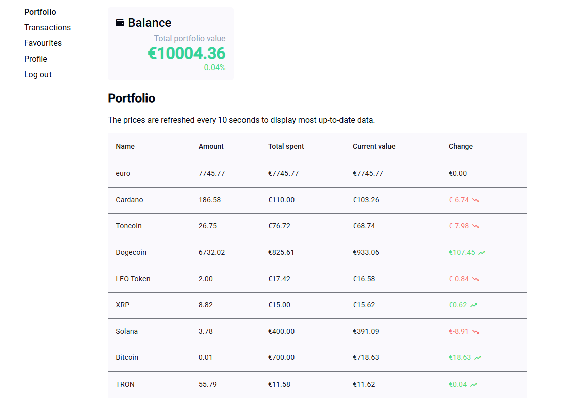
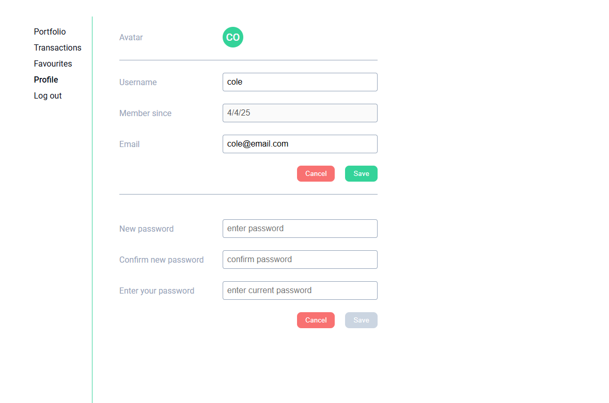
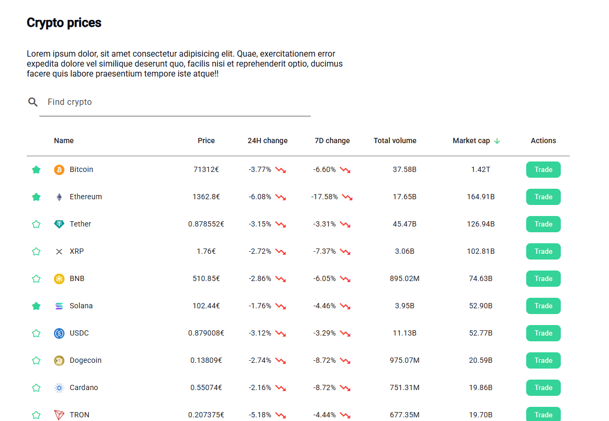
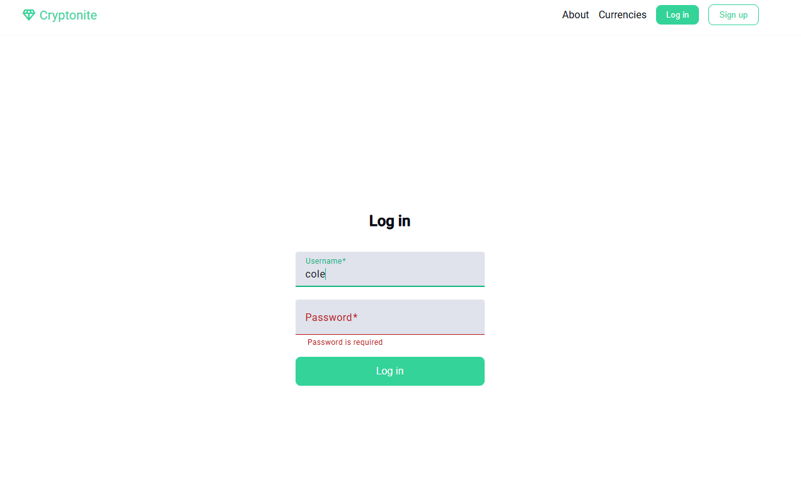
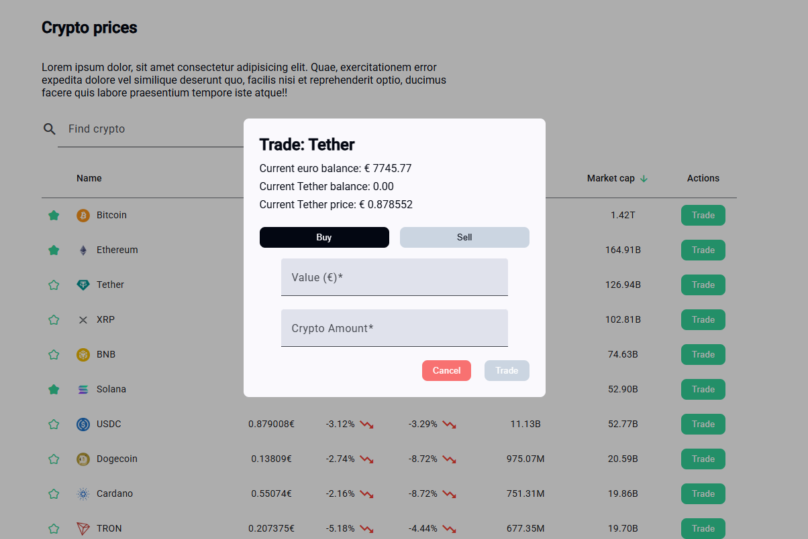

# Cryptonite

## Contents

- [Live demo](#live-demo)
- [Sign in](#sign-in)
- [Project description](#project-description)
- [Tech stack](#tech-stack)
- [Installation](#installation)
- [Screenshots](#screenshots)

## Live demo

<b> [Link to the live demo](https://cryptonite-lemon.vercel.app/)</b> <br>

## Sign in

To test the app you can log in in with username:

```
user
```

and password: 

```
user123
```

or create a new account

## Project description

Cryptonite is a cryptocurrency trading simulator, where you can:
- buy & sell crypto
- check you portfolio (with up-to-date values)
- check market data (data is refreshed every 10s, using CoinGecko API)
- list your favourite coins
- view transaction history
- manage your account (change password, username, email)

## Tools

built with:
- 
- 
- 
- 
- 
- 

## Installation

### Prerequisites

- [Node.js](https://nodejs.org/) 18+ and npm
- [PostgreSQL](https://www.postgresql.org/)

### 1. Clone the repository

```bash
git clone https://gitlab2.eleks.com/a.kosiedowska/cryptonite.git
cd cryptonite
```

### 2. Install dependencies

```bash
npm install
cd backend && npm install
cd ../frontend && npm install
cd ..
```

### 3. Configure environment variables

Copy the example files and fill in the values:

```bash
cp backend/.env.example backend/.env
cp frontend/.env.example frontend/.env
```

### 4. Set up the database

Create the database, run the migrations and seed the wallet data:

```bash
createdb cryptonite
cd backend
npx knex migrate:latest
npm run wallet
```

### 5. Run the app

Backend (from `backend/`):

```bash
npm run dev
```

Frontend (from `frontend/`):

```bash
npm start
```

The app is then available at `http://localhost:4200` and the API at `http://localhost:8080`.

## Screenshots

 <br>
 <br>
 <br>
 <br>
 <br>
 <br>


